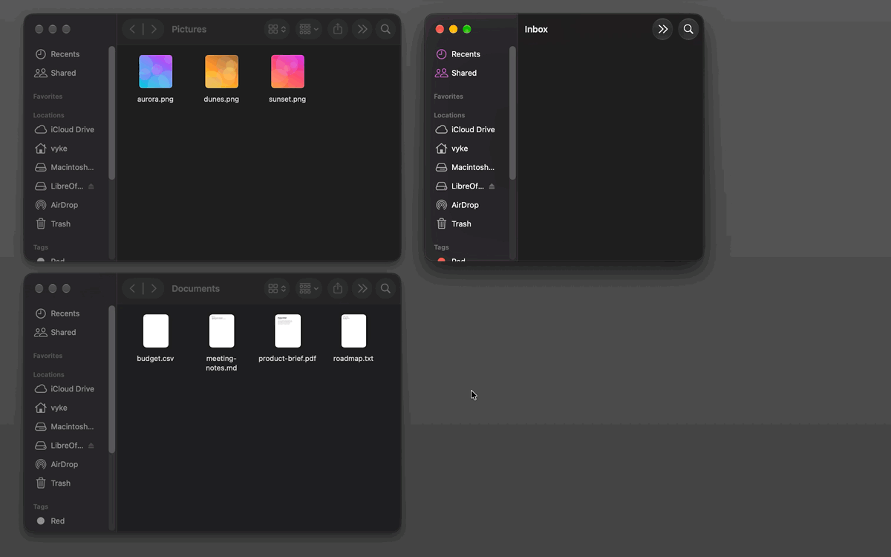
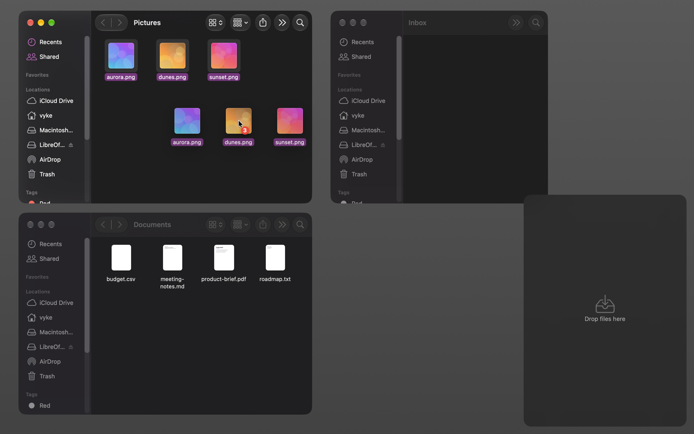
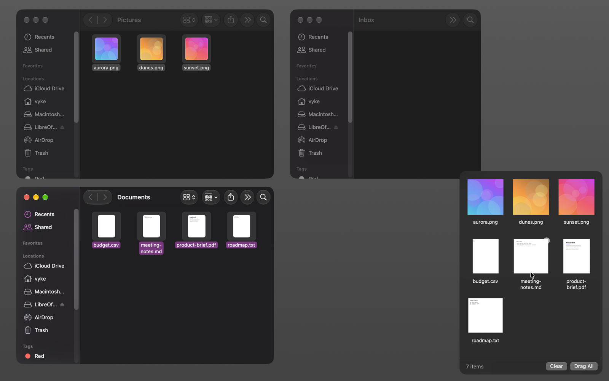
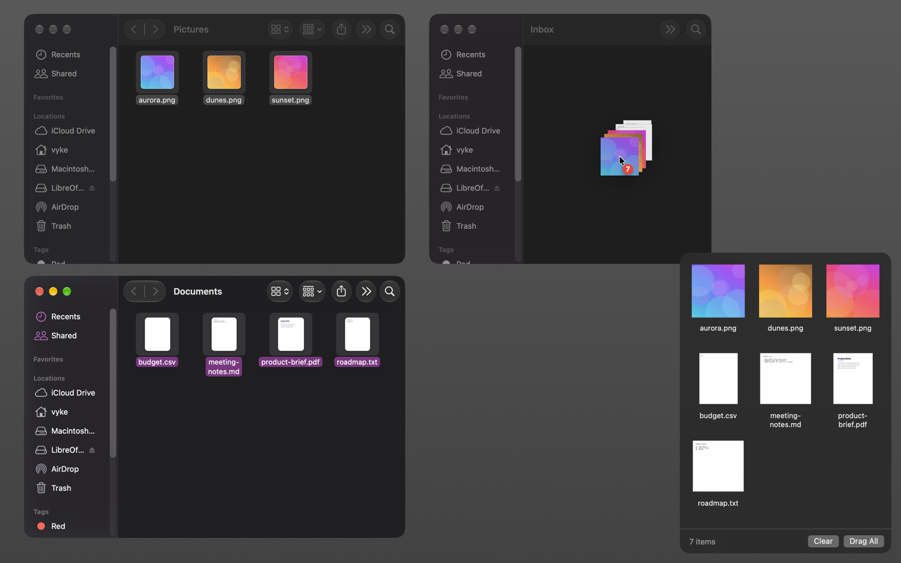
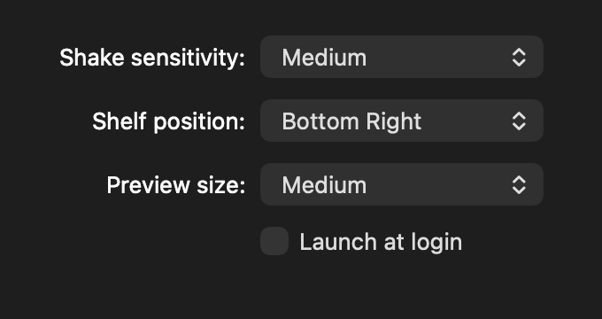

<p align="center">
  
</p>

<h1 align="center">ShakeShelf</h1>

<p align="center">A shelf for collecting files from different folders on your Mac.</p>



## How it works

**1. Shake.** Start dragging files in Finder and shake the pointer. The shelf opens in a corner of the screen.



**2. Collect.** Drop the files on the shelf. Go to other folders and add more.



**3. Deliver.** Drag one file, a selection or everything to the destination folder.



## Notes

- Adding a file to the shelf doesn't move or copy it.
- Dragging out works like Finder: files move on the same disk and copy to another disk. Hold Option to copy.
- Quitting the app empties the shelf.
- There is no menu bar icon. Open the app again to show the shelf, and right-click the shelf for settings.

## Settings



Shake sensitivity, shelf position, preview size and launch at login.

## Building

Requires macOS 13 or later and the Xcode Command Line Tools.

```sh
./build.sh
open ShakeShelf.app
```

Move `ShakeShelf.app` to `/Applications` to keep it. The app isn't notarized, so macOS shows a warning on copies downloaded from elsewhere.

To run the shake detection checks:

```sh
swift run ShakeChecks
```

## License

[MIT](LICENSE)
